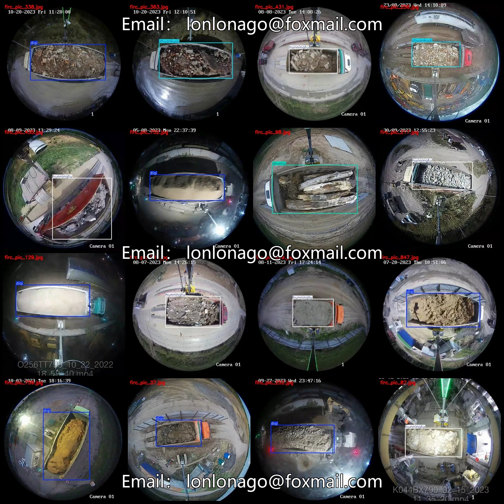
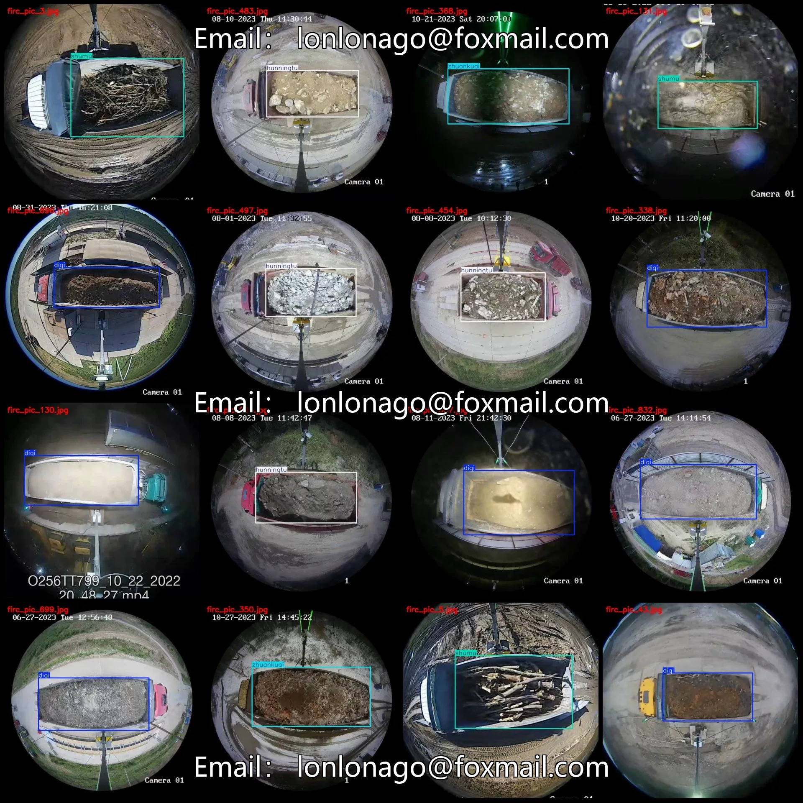
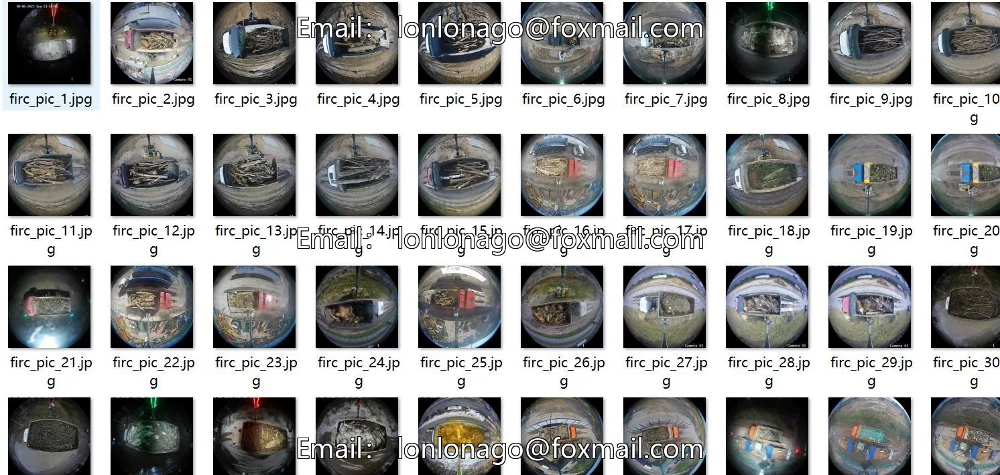
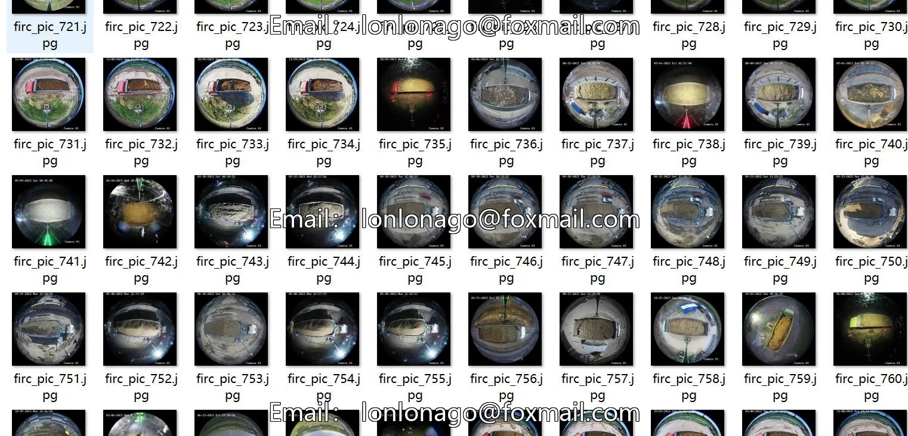
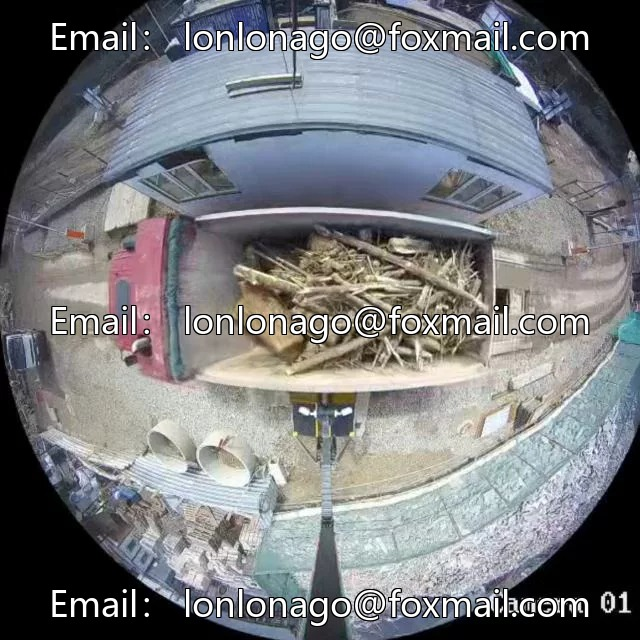
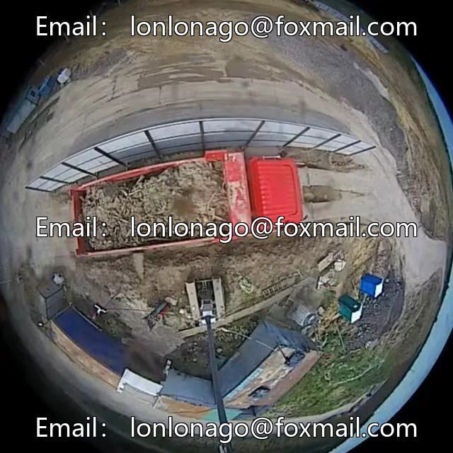

# Vehicle Load Type Detection Dataset in Fish Eye View - VOC+YOLO format, 88

## Body

Aquarium Eye Monitoring Viewpoint: Truck Load Type Detection Dataset VOC+YOLO Format - 887 Images in 4 Categories
Warm Reminder: Due to the dataset's replicability, please confirm compliance with requirements before purchasing.
Dataset Format: Pascal VOC format + YOLO format (txt file without split path, only containing jpg images and corresponding VOC format xml files and yolo format txt files)
Number of Images (Total jpg files): 887
Number of Annotations (Total xml files): 887
Number of Annotations (Total txt files): 887
Number of Annotation Categories: 4

Label category names (Note that the order of categories in the YOLO format does not correspond to this, but is based on the labels folder's classes.txt): ["diqi", "hunningtu", "shumu", "zhuankuai"]
["paint", "concrete", "trees", "bricks"]
Number of boxes labeled in each category
Diqi Frame Count = 437
Hunningtu Frames = 269
shumu box count = 81
zhuankuai Frames = 101
Total frame count: 888
Number of images per category
Diqi owns 436 images.

Hunningtu occupies 269 images
Shumu occupies 81 images
Zhuankuai occupies 101 images
Image resolution: 640x640
Labeling tool used: labelImg
Labeling rules: Draw a rectangle around the category
Important note: The dataset does not have separate training, validation, and test sets; you need to partition them yourself.
Special declaration: This dataset does not guarantee the accuracy of the trained models or weight files.

## Images

## Payment

Here is a pay link on Stripe ( https://buy.stripe.com/3cs8yP7sY87d0vu9AB ). Please contact me lonlonago@foxmail.com after funding $89, and I will send you a complete data files , thank you!

